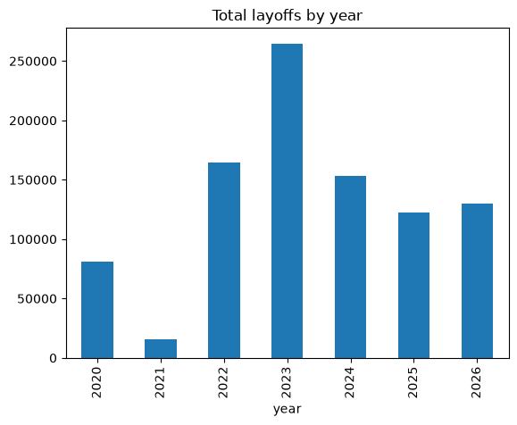

Tech Layoffs Analysis (2020-2026) 

An exploratory data analysis (EDA) of global tech layoffs, built in Python. The project cleans a real, messy dataset and answers one question: **which companies, industries, countries and funding stages were hit hardest, and who shut down completely?**

## Key Findings

1. **Layoffs peaked in 2023** at about 264,000 jobs (up from about 164,000 in 2022). January 2023 was the worst single month, with about 90,000 layoffs.
2. **The United States accounts for about 70% of all layoffs** (about 660,000), followed by India (about 67,000) and Germany (about 31,000).
3. **Amazon leads by company** (about 59,000), then Intel (about 43,000), and Meta and Microsoft (about 36,000 each). By industry, Retail and Hardware lead among named categories.
4. **Big companies cut the most jobs, but small startups are the ones that shut down.** Post-IPO companies have the highest layoff totals, yet Seed, Series A and Series B companies make up about half of the 374 records showing a 100% layoff.

## Dataset

- **Source:** Kaggle "Layoffs Dataset" (swaptr), which is based on [layoffs.fyi](https://layoffs.fyi)
- **Size:** 4,615 records, 11 columns (company, location, total laid off, date, percentage laid off, industry, source, stage, funds raised, country, date added)

## Data Cleaning

- Found 4 hidden duplicates (same company, location, date, layoff count, stage and country) and removed them
- Converted `date` and `date_added` from text to dates; added `year` and `month` columns
- Trimmed extra spaces in text columns
- Merged "UAE" into "United Arab Emirates"
- Filled missing industry, stage, country and location with "Unknown"
- Left missing `total_laid_off` (1,600), `percentage_laid_off` (1,728) and `funds_raised` (550) empty on purpose, because filling them with 0 or an average would invent data

## Analysis Performed

- Total layoffs by year and by month
- Top 10 industries, countries and companies by layoffs
- Layoffs by funding stage
- Complete shutdowns (100% layoffs) by funding stage

## Limitations

- About 1,600 rows have no layoff count, so all totals are undercounts.
- A 100% layoff suggests a shutdown, but it may also mean a single office or team was closed.
- The data is dominated by US companies, and 2026 is a partial year (data runs to September).

## Tools

Python, pandas, matplotlib, Jupyter Notebook

## Author

POOJASHREE V
